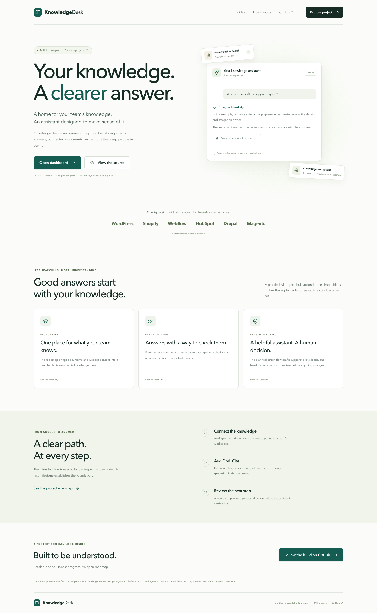
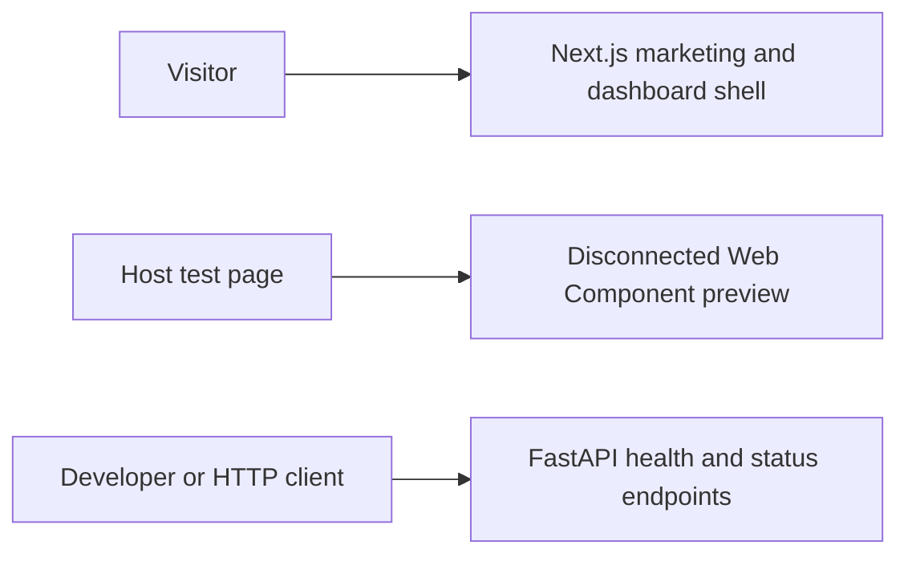

# KnowledgeDesk

An open-source AI knowledge assistant being built around cited answers and human-approved actions.

[](https://github.com/iamhamzakhokhar/ai-knowledge-assistant/actions/workflows/ci.yml)

Built by Hamza Zahid Khokhar.

## Current status

This repository contains the **issue #1 foundation**: a responsive marketing page,
a project dashboard shell, a FastAPI health/status service, and a disconnected
embeddable widget preview. The dashboard describes the roadmap; it is not an
authenticated workspace. The marketing page's answer illustration uses fictional
sample content.

Knowledge ingestion, retrieval, model-generated chat, citations, authentication,
team isolation, agent actions, analytics, billing and MCP are **not implemented
yet**. No API key is needed to explore the current shell.

**Live demo:** not deployed.



[View the mobile workspace](docs/images/workspace-mobile.png).

This is a portfolio project. It has no claimed customers, revenue or production
traffic. Follow the [issues](https://github.com/iamhamzakhokhar/ai-knowledge-assistant/issues)
and [milestones](https://github.com/iamhamzakhokhar/ai-knowledge-assistant/milestones)
for implementation progress.

## What works now

- Next.js marketing page at `/` and a responsive project overview at `/dashboard`.
- FastAPI `GET /health`, `GET /api/v1/status` and generated OpenAPI docs at `/docs`.
- A standalone TypeScript Web Component with Shadow DOM, one-script mounting,
  branding settings, keyboard controls and a clear disconnected state.
- Workspace commands for formatting/linting, type checking, builds and tests.

## Tech stack

The foundation uses Next.js **16.4.5**, React **19.3.1**, TypeScript **7.0.2**,
Tailwind CSS **4.3.5**, Python **3.15.2** and FastAPI **0.162.2**. The widget has
no runtime dependencies. Biome and Ruff handle formatting/linting; pytest and
Playwright cover the foundation's important behavior.

See [verified versions and official release sources](docs/versions.md). The
planned database, worker, AI provider, tracing and billing dependencies will be
selected and pinned when their feature issues are implemented.

## Repository layout

```text
apps/web/          Next.js marketing page and dashboard shell
services/ai/       FastAPI service, settings and API tests
packages/widget/   Standalone Web Component and classic-script build
docs/              Current architecture, planned design and version sources
.github/           CI and repository automation
```

## Architecture

The current components are independent; the web shell does not call the AI
service or provide working chat.



The [architecture guide](docs/architecture.md) separates this implemented
foundation from the planned tenant-aware ingestion, retrieval and action flow.

## Getting started

Install Node.js **26.13.0**, Python **3.15.2**, pnpm **12.18.0** and uv **0.13.7**.
The versions are recorded in `.node-version`, `.python-version` and the package
manifests. Install [gitleaks](https://github.com/gitleaks/gitleaks#installing)
before pushing; the local pre-push hook requires it.

```sh
git clone https://github.com/iamhamzakhokhar/ai-knowledge-assistant.git
cd ai-knowledge-assistant
pnpm install --frozen-lockfile
uv sync --directory services/ai --locked
pnpm setup:hooks
```

Run the web app in one terminal:

```sh
pnpm dev
```

Run the API in another:

```sh
pnpm dev:api
```

Open [the marketing page](http://localhost:3000),
[the dashboard shell](http://localhost:3000/dashboard),
[API health](http://localhost:8000/health),
[capability status](http://localhost:8000/api/v1/status) or
[OpenAPI docs](http://localhost:8000/docs).

For a separate HTML page, build the widget with
`pnpm --filter @aka/widget build` and follow its
[installation preview instructions](packages/widget/README.md).

## Environment variables

The defaults work for the setup shell. [`.env.example`](.env.example) documents
the public variable names; real secrets must stay outside version control.

| Variable              | Default                 | Current use                                                            |
| --------------------- | ----------------------- | ---------------------------------------------------------------------- |
| `APP_ENV`             | `development`           | API environment: `development`, `test` or `production`.                |
| `CORS_ORIGINS`        | `http://localhost:3000` | Comma-separated exact HTTP(S) origins for the API.                     |
| `NEXT_PUBLIC_API_URL` | `http://localhost:8000` | Reserved public API base URL; the shell does not call the service yet. |

The API reads exported environment variables and does not automatically load
`.env` files. CORS restricts browser origins; it does not authenticate clients.
Never put a provider key in a `NEXT_PUBLIC_*` variable.

## Running checks

Install the browser used by the smoke tests once:

```sh
pnpm exec playwright install chromium
```

Then run the repository checks:

```sh
pnpm lint
pnpm typecheck
pnpm build
pnpm test
```

Use `pnpm test:api` or `pnpm test:browser` to run a single suite. Use `pnpm format`
to apply the configured formatters. `pnpm setup:hooks` installs repository-local
hooks: pre-commit checks formatting/lint, and pre-push scans Git history with
gitleaks using redacted output.

Current foundation validation on Node 26.13.0 and Python 3.15.2:

- 15 API tests pass, including status behavior, configuration validation and exact-origin CORS handling.
- 6 Chromium browser tests pass across desktop and mobile: navigation, widget keyboard behavior and safe greeting rendering.
- API foundation coverage is 100% of 58 statements and 6 branches. This small scope does not represent coverage of the planned product.
- Biome/Ruff checks, TypeScript checks, the web/widget production builds and Python wheel/source builds pass.

Live-model evaluations, complete accessibility conformance and Lighthouse scores are not measured yet. The CI badge links to the actual workflow result; it does not imply that planned features have been validated.

## Roadmap

- [Setup](https://github.com/iamhamzakhokhar/ai-knowledge-assistant/milestone/1): issues #1–#3 establish tooling, local services, migrations, CI and repository security.
- [Core features](https://github.com/iamhamzakhokhar/ai-knowledge-assistant/milestone/2): issues #4–#15 deliver tenancy, ingestion, retrieval, cited chat, widget integration, approvals, actions, analytics, billing and MCP.
- [Quality](https://github.com/iamhamzakhokhar/ai-knowledge-assistant/milestone/3): issues #16–#21 cover guardrails, limits, evaluations, integration tests, accessibility, performance and tracing.
- [Release](https://github.com/iamhamzakhokhar/ai-knowledge-assistant/milestone/4): issues #22–#25 deliver the safe demo, deployment, documentation and v1.0.0.

## Deployment

Deployment is planned in [issue #23](https://github.com/iamhamzakhokhar/ai-knowledge-assistant/issues/23).
The intended targets are Vercel for the web app and a supported host for the
FastAPI service and background worker, with PostgreSQL/pgvector and Redis. No live
deployment or deployment verification is claimed at this stage.

## Contributing and license

See [CONTRIBUTING.md](CONTRIBUTING.md) for the issue/branch/PR workflow and
[AGENTS.md](AGENTS.md) for coding-agent instructions. Licensed under
[MIT](LICENSE).
