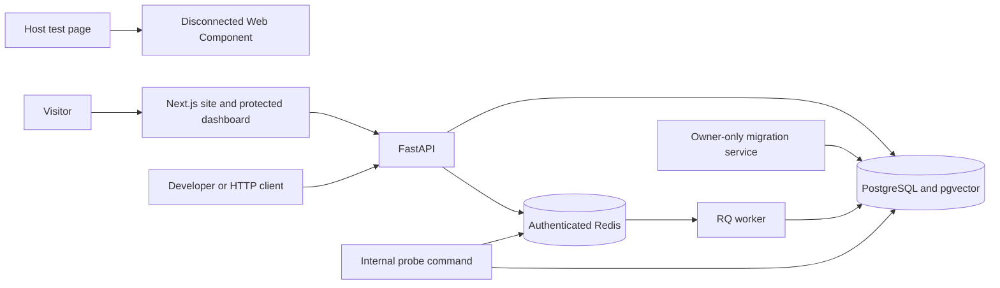

# KnowledgeDesk

An open-source AI knowledge assistant being built around cited answers and human-approved actions.

[](https://github.com/iamhamzakhokhar/ai-knowledge-assistant/actions/workflows/ci.yml)
[](https://github.com/iamhamzakhokhar/ai-knowledge-assistant/actions/workflows/security.yml)
[](https://github.com/iamhamzakhokhar/ai-knowledge-assistant/actions/workflows/codeql.yml)

Built by Hamza Zahid Khokhar.

## Current status

The application includes a responsive marketing page, an authenticated team
dashboard, a FastAPI service, and a disconnected embeddable widget preview.
It also includes a Docker Compose environment with PostgreSQL/pgvector, Redis,
Alembic migrations, tenant-scoped tables, fictional seed data, and an RQ worker
that extracts text from uploaded documents.

Users can create an account, create a team, or join by invitation. Every team
request checks the current membership and role on the server. Teams can upload
PDF, DOCX, and Markdown files and preview the extracted text. Website ingestion,
retrieval, model-generated chat, citations, agent actions, analytics, billing
and MCP are **not implemented yet**. The marketing answer
illustration uses fictional content. No model or identity provider key is needed
for local development.

**Live demo:** not deployed.


[View the original mobile project overview](docs/images/workspace-mobile.png).

This is a portfolio project. It has no claimed customers, revenue or production
traffic. Follow the [issues](https://github.com/iamhamzakhokhar/ai-knowledge-assistant/issues)
and [milestones](https://github.com/iamhamzakhokhar/ai-knowledge-assistant/milestones)
for implementation progress.

## What works now

- Next.js marketing page at `/`, public project overview at `/project`, and
  a protected workspace at `/dashboard`.
- Account sign-up and sign-in, server-side sessions, invitation-based teams,
  and owner/admin/member permissions. See the [authentication guide](docs/authentication.md).
- FastAPI liveness, dependency readiness, capability status and OpenAPI docs.
- A standalone TypeScript Web Component with Shadow DOM, branding settings,
  keyboard controls and a clear disconnected state.
- PostgreSQL tables with forced row-level security, owner-only migrations,
  transaction-local tenant context and idempotent fictional seeds.
- [Private document ingestion](docs/document-ingestion.md) with a JSON RQ worker,
  status tracking, retries, and text previews. Only team owners and admins can
  upload and retry.
- Compose health checks, persistent volumes, separated local credentials,
  and an opt-in integration/recovery test workflow.

## Tech stack

The web uses Next.js **16.4.5**, React **19.3.1**, TypeScript **7.0.2** and
Tailwind CSS **4.3.5**. The service uses Python **3.15.2**, FastAPI **0.162.2**,
SQLAlchemy **2.1.8**, Alembic **1.20.1** and psycopg **3.3.8**. The local stack
uses PostgreSQL **18** with pgvector **0.8.7**, Redis **8.10.3**, redis-py
**8.1.0** and RQ **3.0.0**. The widget has no runtime dependencies.

Biome and Ruff handle formatting/linting; pytest and Playwright cover important
behavior. See [version pins and official sources](docs/versions.md).

## Repository layout

```text
apps/web/          Next.js marketing page and dashboard shell
services/ai/       FastAPI, database boundary, migrations, worker and tests
packages/widget/   Standalone Web Component and classic-script build
docs/              Architecture, local infrastructure and version sources
scripts/           Disposable Compose integration/recovery runner
.github/           CI and repository automation
compose.yaml       Local services, networks, health checks and persistent volumes
```

## Architecture

The UI and widget remain disconnected from the future chat workflow. The API
can check infrastructure readiness; the internal worker probe exercises Redis
and the tenant-scoped database boundary.



Read the [architecture guide](docs/architecture.md) for implemented boundaries
and the planned ingestion, retrieval and approval flow.

## Getting started

Install Docker Engine or Docker Desktop with Docker Compose, then run:

```sh
git clone https://github.com/iamhamzakhokhar/ai-knowledge-assistant.git
cd ai-knowledge-assistant
docker compose up --build --wait
```

Compose builds the applications, generates credentials inside private Docker
volumes, starts PostgreSQL and Redis, applies migrations, and waits for the web,
API and worker health checks. Password values do not need to be copied to host
files or exported into the shell.

Open [the marketing page](http://localhost:3000),
[create a local account](http://localhost:3000/signup), or
[sign in to your dashboard](http://localhost:3000/login). The API provides
[API liveness](http://localhost:8000/health),
[dependency readiness](http://localhost:8000/ready),
[capability status](http://localhost:8000/api/v1/status) or
[OpenAPI docs](http://localhost:8000/docs).

Add the two fictional example teams and sources when needed:

```sh
docker compose --profile tools run --rm seed
```

Seeding is idempotent. These records demonstrate storage and tenant scoping;
they are not assigned to newly registered users and do not demonstrate ingestion
or retrieval.

```sh
docker compose down
```

The normal shutdown preserves project data and credentials. See the
[infrastructure guide](docs/infrastructure.md) for probes, migrations, backups,
restore verification and deliberate resets.

With pnpm installed, `pnpm infra:up`, `pnpm infra:seed` and `pnpm infra:down`
run the same Compose operations.

### Editing without Docker

Install Node.js **26.13.0**, Python **3.15.2**, pnpm **12.18.0**, uv
**0.13.7** and Gitleaks **8.30.1** (see [contributor setup](CONTRIBUTING.md)),
then install dependencies and repository-local hooks:

```sh
pnpm install --frozen-lockfile
uv sync --directory services/ai --locked
pnpm setup:hooks
```

Run `pnpm dev` for the web app and `pnpm dev:api` in a separate terminal for the
API shell. `/health` works without infrastructure; `/ready` returns `503` until
database and Redis credentials/connections are configured. The complete local
infrastructure flow runs inside Compose because its database and Redis ports
are private.

Build the widget with `pnpm --filter @aka/widget build` and follow its
[installation preview instructions](packages/widget/README.md).

## Configuration

[`.env.example`](.env.example) documents supported variable names. The API reads
its process environment and does not automatically load `.env` files. Compose
provides its service configuration and secret-file paths directly.

- `APP_ENV` selects `development`, `test` or `production`.
- `CORS_ORIGINS` lists exact browser origins. Mutations require a matching
  Origin, independently of the session check. File uploads use binary bodies;
  other session and team mutations use JSON.
- `API_INTERNAL_URL` is the server-only FastAPI origin used by Next.js. Compose
  sets it to `http://api:8000`. The browser uses same-origin application routes.
- `NEXT_PUBLIC_API_URL` is reserved public browser configuration. Never put a
  session or provider secret in a `NEXT_PUBLIC_*` value.
- `DATABASE_*` and `REDIS_*` configure internal connections. Password settings
  point to mounted files; API and worker receive only application credentials.
- `WEB_PORT` and `API_PORT` can override the default loopback ports `3000` and
  `8000` for a Compose project.

## Running checks

Install the browser once, then run the repository checks:

```sh
pnpm exec playwright install chromium
pnpm lint
pnpm typecheck
pnpm build
pnpm test
```

`pnpm test:api` runs unit tests without service connections; integration cases
skip unless explicitly enabled. `pnpm test:browser` covers signed-out navigation
and the widget; CI also runs the account and team flow against its disposable
Compose stack. Use `pnpm format` to apply the configured formatters. Repository-local
pre-commit scans staged content for secrets and checks formatting/lint; pre-push runs
[gitleaks](https://github.com/gitleaks/gitleaks#installing) with redacted output.

For real service checks after starting and seeding Compose:

```sh
docker compose --profile test run --rm --build integration-tests
```

`pnpm infra:test` is the equivalent repository shortcut.

The integration suite exercises pgvector, role privileges, row-level security,
connection-pool tenant reset, owner-only migration state, a real JSON worker
probe, readiness and Redis authentication. Migration roundtrips use a separate
disposable database. CI is configured to also check restart persistence and a
backup/restore roundtrip in an isolated Compose project.

The [CI workflow](https://github.com/iamhamzakhokhar/ai-knowledge-assistant/actions/workflows/ci.yml)
is the source for actual run results and the measured combined coverage report.
The [recorded infrastructure run](https://github.com/iamhamzakhokhar/ai-knowledge-assistant/actions/runs/42577536707)
passed **104 Python tests** (81 unit and 23 real-service integration cases),
reported **88% combined statement/branch coverage of the Python service**, and
passed **6 desktop/mobile browser tests**. It also verified restart persistence
and a database backup/restore roundtrip. These figures cover the implemented
setup, not the planned AI product.

Local unit results alone do not establish infrastructure or recovery behavior.
Live-model evaluations, complete accessibility conformance and Lighthouse
scores are not measured yet.

## Roadmap

Repository checks include full-history secret scanning, staged-content hooks,
workflow validation, dependency auditing, and CodeQL for Actions, JavaScript/
TypeScript, and Python. Dependabot checks five dependency ecosystems weekly.
Read the [security guide](docs/security.md) for the pnpm dependency-graph limitation
and [SECURITY.md](SECURITY.md) to report a vulnerability privately.

- [Setup](https://github.com/iamhamzakhokhar/ai-knowledge-assistant/milestone/1): issues #1–#3 establish application shells, local services, migrations, CI and repository security.
- [Core features](https://github.com/iamhamzakhokhar/ai-knowledge-assistant/milestone/2): issues #4–#15 deliver authenticated tenancy, ingestion, retrieval, cited chat, widget integration, approvals, actions, analytics, billing and MCP.
- [Quality](https://github.com/iamhamzakhokhar/ai-knowledge-assistant/milestone/3): issues #16–#21 cover guardrails, limits, evaluations, wider integration coverage, accessibility, performance and tracing.
- [Release](https://github.com/iamhamzakhokhar/ai-knowledge-assistant/milestone/4): issues #22–#25 deliver the safe demo, deployment, documentation and v1.0.0.

## Deployment

Deployment is planned in [issue #23](https://github.com/iamhamzakhokhar/ai-knowledge-assistant/issues/23).
The intended targets are Vercel for the web app and a supported host for the
FastAPI service and worker, with PostgreSQL/pgvector and Redis. Compose is for
local development. No live deployment verification is claimed at this stage.

## Contributing and license

See [CONTRIBUTING.md](CONTRIBUTING.md) for the issue/branch/PR workflow and
[AGENTS.md](AGENTS.md) for coding-agent instructions. Licensed under [MIT](LICENSE).
