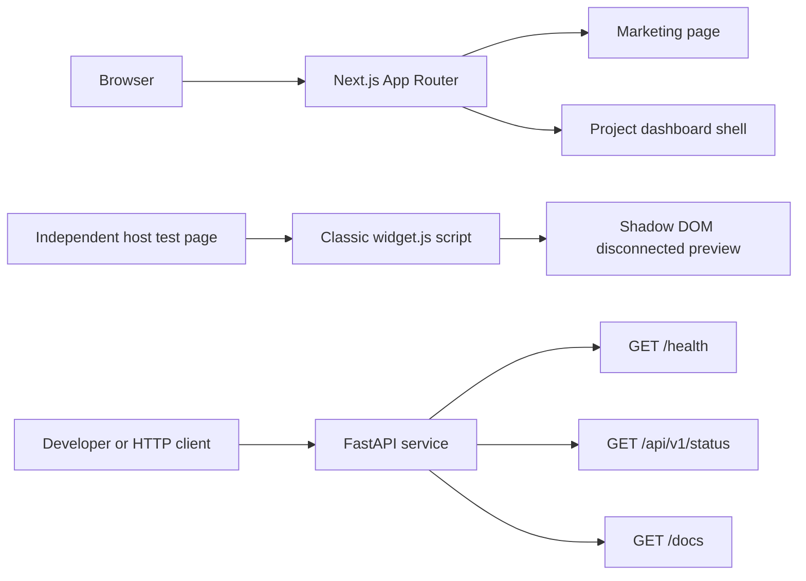
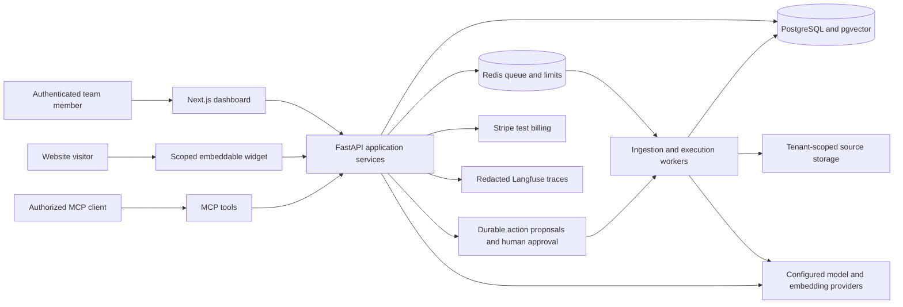

# Architecture

KnowledgeDesk is a portfolio project by Hamza Zahid Khokhar. This document labels
the implemented setup separately from the design for future feature issues.

## Implemented foundation

- `apps/web` renders a responsive marketing page and a public project overview.
  Its sample answer is explicitly illustrative. There is no sign-up, document
  upload, actual conversation or authenticated workspace.
- `services/ai` exposes typed liveness and implementation-status responses.
  `/health` reports process liveness only; it does not test a database, model
  provider or another external dependency. Status lists the unimplemented AI
  capabilities as false. Settings validate exact CORS origins and environment.
- `packages/widget` builds a dependency-free classic script. It registers
  `<aka-chat-widget>` and can mount it from one script tag. Its non-modal panel
  stays closed until opened, supports keyboard closing/focus restoration, and
  states that messaging is disconnected. Configured greetings use `textContent`;
  brand colors are checked with `CSS.supports`.

These components have no application data flow between them yet. PostgreSQL,
pgvector, Redis, workers, model SDKs, subscriptions and MCP are not part of the
implemented foundation.

## Planned architecture

The following diagram is a design target, not a diagram of running services.
Resource choices and exact interfaces will be finalized in their feature issues.

## Planned boundaries

### Identity and tenancy

Server-side identity determines the team and role. Clients, widgets and jobs
cannot grant themselves a tenant by submitting its ID. Database policies and
application checks will isolate documents, chunks, citations, actions, usage and
analytics. Tenant context must be set within each database transaction, using an
application role that cannot bypass row-level security. File keys, caches and
background jobs need the same isolation rules.

A widget identifier is public configuration. Allowed-domain checks and CORS are
abuse/browser-origin controls, not authentication. Widget sessions will be
short-lived, narrowly scoped and subject to team/session budgets. MCP tools must
reuse the application's role checks and approval path.

### Knowledge ingestion and retrieval

Uploads and bounded website crawls will produce durable jobs. Crawlers must
validate the actual connection destination and every redirect, enforce public
network boundaries and stop at documented page/byte/time limits. Parsing and
indexing failures must have visible states and safe retries.

Each active document version will own its chunks, embedding-model metadata and
stable citation anchors. Keyword/vector queries and reranking must all filter
authorized active sources. Updates and deletions must change search visibility
and invalidate relevant caches. Changing an embedding model requires a compatible
index or an explicit reindex.

### Answers and actions

Provider-specific adapters will keep API keys server-side and implement a shared
streaming/schema contract. Answers must cite available authorized evidence and
state when the knowledge base is insufficient. Untrusted source content cannot
change authorization or tool policy.

Proposed actions will be immutable, tenant-scoped records. A human approval binds
to the exact payload; changing it requires another review. Execution must recheck
current authorization, use idempotency keys and retain an audit trail across
retries. Read-only chat responses and approved external side effects are separate
workflows.

### Usage, privacy and operations

Atomic reservations will enforce limits before costly work, with reconciliation
for actual tokens, failures and cancellation. Cache keys must include tenant and
knowledge/configuration context. Billing entitlements come from verified,
deduplicated Stripe test events rather than client assertions.

Traces should correlate API requests, jobs and actions while minimizing personal
data. Provider usage and estimated cost must be labeled distinctly. Backups,
restore checks, deployment health and rollback procedures belong to the release
work, alongside an isolated and bounded public demo.

## Where the work is tracked

[Setup issues #1–#3](https://github.com/iamhamzakhokhar/ai-knowledge-assistant/milestone/1)
establish the foundation. The
[Core features milestone](https://github.com/iamhamzakhokhar/ai-knowledge-assistant/milestone/2)
covers implemented product behavior, followed by measured
[Quality](https://github.com/iamhamzakhokhar/ai-knowledge-assistant/milestone/3)
and [Release](https://github.com/iamhamzakhokhar/ai-knowledge-assistant/milestone/4)
work. An architectural plan does not count as a completed feature or validation.
