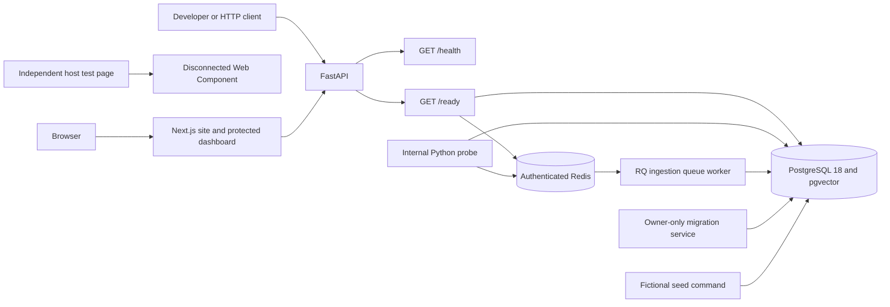
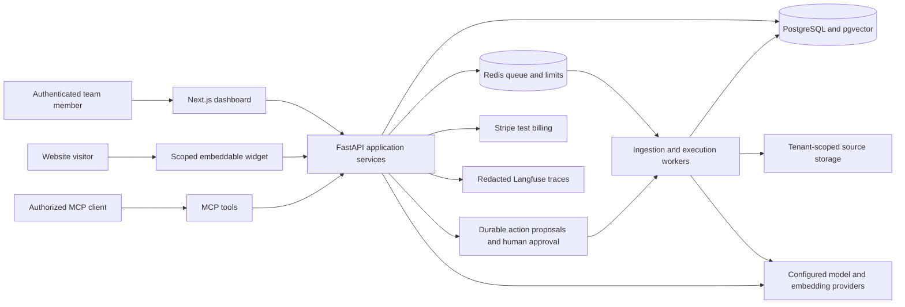

# Architecture

KnowledgeDesk is a portfolio project by Hamza Zahid Khokhar. It implements local
infrastructure, accounts, team authorization, document extraction and website ingestion. Search
and AI workflows remain on the roadmap.

## Implemented architecture

### Web and API

`apps/web` renders a responsive marketing page, public project overview, and
protected team dashboard. Its
sample answer is illustrative. The standalone widget supports one-script mounting,
Shadow DOM, configured text/color, keyboard closing and focus restoration. Both
remain disconnected from a working conversation service.

The API exposes `/health`, `/ready`, `/api/v1/status` and `/docs`. Liveness only
reports that the API process can respond. Readiness returns `200` after the
application database connection executes `SELECT 1` and authenticated Redis
responds to `PING`; failures return a generic `503` without connection details.
Readiness does not assert worker execution or AI capabilities. The status endpoint
reports document and website ingestion separately from retrieval, chat, agents and MCP.

### Storage and the internal tenant boundary

Alembic revision `0001` creates `teams`, `knowledge_sources` and `job_runs` and
enables the vector extension. All three tables enable and force row-level
security. Policies match the transaction's tenant UUID against the team's own
`id` or a row's `team_id`. Without tenant context, the application role sees no
rows. pgvector is available, but document chunks, embeddings and retrieval
indexes have not been implemented.

`aka_owner` applies migrations. Runtime `aka_app` is a non-owner login with
`NOSUPERUSER`, `NOINHERIT` and `NOBYPASSRLS`, table DML and schema usage. It cannot
create schema objects or temporary tables, read migration state, inherit owner
membership, or bypass tenant policies. Bootstrap rejects an existing application
role with unsafe flags, memberships or ownership rather than broadening it.

`tenant_connection` opens a transaction and uses transaction-local
`set_config('app.team_id', ..., true)`. Tenant context ends with commit or
rollback before a connection returns to the pool. Protected HTTP handlers
resolve the actor's current membership before accessing a team's resources;
only trusted server code chooses the database context. Internal seeds and
probes are separate from user authorization.

### Identity and teams

The web server checks an opaque session through FastAPI before displaying the
dashboard. FastAPI checks live membership and role on each protected request.
Account registration, team creation, invite redemption and membership changes
have explicit server-side checks. PostgreSQL stores identity and session state
and isolates tenant resources through transaction-local scope. See
[accounts and teams](authentication.md) for roles, revocation and CSRF rules.

The optional seed command inserts two fictional teams and one example source per
team through the application role. Repeated seeding preserves existing records.
It does not parse documents, call a model or build a knowledge index.

### Document extraction and the worker

Document uploads persist the original bytes and a queued attempt in PostgreSQL.
Forced row-level security protects document and original records. The private
JSON RQ job carries only identifiers and the attempt number. The worker claims
that attempt, checks the uploader's live role, and publishes the complete text
and metadata in one transaction. The job lease and attempt number let a team
recover from an interruption without letting late workers publish stale text.
See [document ingestion](document-ingestion.md) for limits and retry behavior.

The private `ingestion` queue also serves an internal infrastructure probe.
Internal `enqueue_probe` persists a
`queued` job record before enqueueing a fixed dotted task with UUID string
arguments and a deterministic job ID. Producer and worker use `JSONSerializer`;
no pickle payload is needed for this flow.

The worker runs the task under its tenant transaction, moves the existing record
through `running` to `completed`, and stores a small result. Duplicate completed
runs return the same result; queue/execution failures have safe recorded failure
states. Queue/result retention and execution time are bounded. There is no
public probe enqueue route. Possession of the private service
credential is a trusted infrastructure boundary, not an end-user permission.

### Website ingestion

A dedicated JSON RQ queue carries website import identifiers. The website worker
checks public network destinations, follows same-origin links and sitemap indexes,
and stores page provenance. Its bounded attempts publish snapshots atomically.
The [website ingestion guide](website-ingestion.md) describes scope, limits and recrawls.

### Compose boundaries and persistence

[compose.yaml](../compose.yaml) starts `secret-init`, PostgreSQL, Redis,
`migrate`, API, document worker, website worker and web services. PostgreSQL and Redis use the internal
backend network with no published ports. Web/API publish only loopback ports
`3000` and `8000`; the worker has no published port. The API joins both networks
so the web server can reach it. The document worker stays on the private backend
network. The website worker also joins the dedicated `website-egress` network.

The one-shot secret initializer has no network and generates persistent random
credentials inside three private named volumes: `postgres-secrets`,
`app-secrets` and `redis-secrets`. PostgreSQL/migration bootstrap and opt-in tests
can read the owner credential. API and worker mount only the application volume
read-only and run as UID/GID `10001`; they receive no owner password. Redis reads
its private password/config volume. Repeated startup preserves existing secrets.
Files are owner-only (`0400`) for the consuming service UID. PostgreSQL and
migration/test UIDs receive separate identical files in the PostgreSQL volume;
supplementary group access permits directory traversal only.

PostgreSQL data is mounted at `/var/lib/postgresql`, as required by the selected
PostgreSQL 18 image layout. Redis persists data under `/data` with append-only
storage enabled. Normal Compose shutdown keeps data and secret volumes.
The [infrastructure guide](infrastructure.md) covers startup, migrations and
explicitly scoped recovery/reset operations.

## Verification boundary

Unit tests can run without service connections. The opt-in integration suite
uses real PostgreSQL, Redis, web, API and worker services; its migration
roundtrip creates and removes a separate `aka_test_<uuid>` database. A CI runner
uses a disposable `aka-ci-...` Compose project to exercise clean startup,
fictional seeds, tenant isolation, JSON worker completion, restart persistence
and a backup/restore check. Those checks establish evidence only when their
workflow run passes; implementation and unit results alone do not prove them.

## Planned architecture

The following diagram is a design target, not a diagram of running services.
Resource choices and exact interfaces will be finalized in their feature issues.

## Planned boundaries

### Identity and tenancy

Extend the existing membership checks and database scope to chunks, citations,
actions, usage and analytics as those features are built. File keys, caches
and background jobs need the same isolation rules.

A widget identifier is public configuration. Allowed-domain checks and CORS are
abuse/browser-origin controls, not authentication. Widget sessions will be
short-lived, narrowly scoped and subject to team/session budgets. MCP tools must
reuse the application's role checks and approval path.

### Knowledge ingestion and retrieval

Document uploads and bounded website crawls produce durable jobs. Future
indexing must preserve their access controls, provenance and recovery behavior.

Each active document version will own its chunks, embedding-model metadata and
stable citation anchors. Keyword/vector queries and reranking must all filter
authorized active sources. Updates and deletions must change search visibility
and invalidate relevant caches. Changing an embedding model requires a compatible
index or an explicit reindex.

### Answers and actions

Provider-specific adapters will keep API keys server-side and implement a shared
streaming/schema contract. Answers must cite available authorized evidence and
state when the knowledge base is insufficient. Untrusted source content cannot
change authorization or tool policy.

Proposed actions will be immutable, tenant-scoped records. A human approval binds
to the exact payload; changing it requires another review. Execution must recheck
current authorization, use idempotency keys and retain an audit trail across
retries. Read-only chat responses and approved external side effects are separate
workflows.

### Usage, privacy and operations

Atomic reservations will enforce limits before costly work, with reconciliation
for actual tokens, failures and cancellation. Cache keys must include tenant and
knowledge/configuration context. Billing entitlements come from verified,
deduplicated Stripe test events rather than client assertions.

Traces should correlate API requests, jobs and actions while minimizing personal
data. Provider usage and estimated cost must be labeled distinctly. Backups,
restore checks, deployment health and rollback procedures belong to the release
work, alongside an isolated and bounded public demo.

## Where the work is tracked

[Setup issues #1–#3](https://github.com/iamhamzakhokhar/ai-knowledge-assistant/milestone/1)
establish the foundation. The
[Core features milestone](https://github.com/iamhamzakhokhar/ai-knowledge-assistant/milestone/2)
covers implemented product behavior, followed by measured
[Quality](https://github.com/iamhamzakhokhar/ai-knowledge-assistant/milestone/3)
and [Release](https://github.com/iamhamzakhokhar/ai-knowledge-assistant/milestone/4)
work. An architectural plan does not count as a completed feature or validation.
